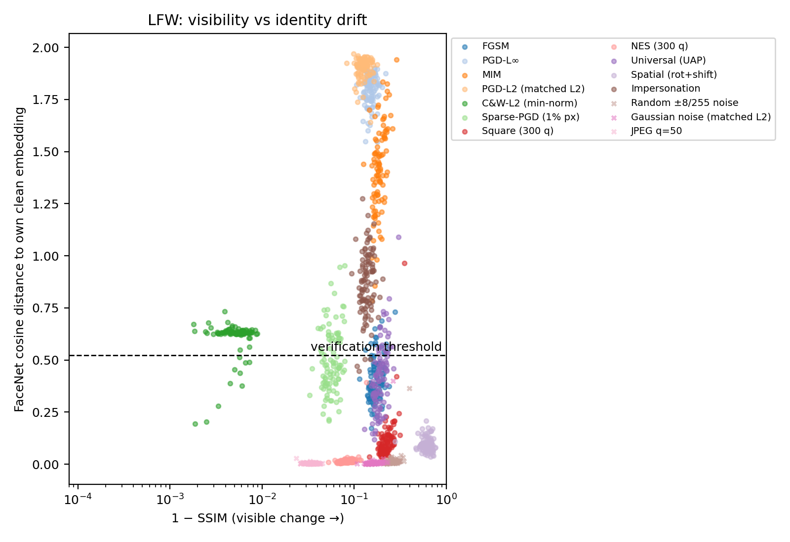

# Adversarial Attacks on Face Recognition: Beyond Fooling Rates

This project studies **how** adversarial attacks change face images, not just **whether** they fool a face recognition model.
Each attack is measured at three levels:

- **Pixel / perceptual:** SSIM, PSNR, SNR, UQI, LPIPS. How visible is the change?
- **Statistical:** MSE, total variation, Pearson correlation, normalised mutual information, FID, KID. Does the image stay statistically natural?
- **Identity / embedding:** cosine drift, verification flips, rank-1 identification, top-5 consistency, transfer to ArcFace. Does the model still recognise the person?

We also measure **where on the face** each perturbation concentrates (eyes, nose, mouth, rest), using MTCNN landmarks.

> **The current, corrected pipeline is in [`advface/`](advface/).**
> `Face_Recognition (1).ipynb` is the earlier prototype and is kept for reference only. It contains known issues, listed at the bottom of this file.

## Setup

| Component | Choice |
|---|---|
| Face detection | MTCNN (facenet-pytorch): 160×160 crop with margin, 5 landmarks |
| Target model | FaceNet-style InceptionResnetV1 (facenet-pytorch), trained on VGGFace2, 512-d embeddings |
| Transfer model | ArcFace (InsightFace, MobileFaceNet backbone) |
| Decision rule | Verification: cosine distance below a threshold calibrated on 150 held-out identities (FaceNet: 0.524, ArcFace: 0.767; both ≈97% accuracy) |
| Threat model | Dodging: perturb photo A of a person so it no longer matches photo B of the same person |
| Budget | L∞ ε = 8/255 for pixels in [0, 1] (= 16/255 in [−1, 1]) |
| Data | LFW (deep-funneled): 99 attacked identities, 150 disjoint calibration identities. CelebA is supported by the same scripts. |

**Attacks:** FGSM, PGD-L∞, MIM, PGD-L2 (matched L2), C&W-L2 (minimum-norm), Sparse-PGD (1% of pixels), Square (300 queries), NES (300 queries), Universal perturbation, Spatial (rotation + shift), Impersonation (targeted feature-level).

**Controls (non-adversarial):** random ±8/255 noise, Gaussian noise at matched L2, JPEG q=50.

## Main results (LFW, 99 identities)

| Attack | SSIM ↑ | PSNR (dB) ↑ | FID ↓ | Identity drift | Verification flip rate | ArcFace transfer |
|---|---|---|---|---|---|---|
| PGD-L∞ | 0.849 | 32.7 | 151 | 1.80 | 100% | 17% |
| PGD-L2 (matched L2) | 0.874 | 32.9 | 158 | 1.90 | 100% | 34% |
| C&W-L2 (min-norm) | 0.995 | 48.2 | 8 | 0.61 | 92% | 1% |
| Sparse-PGD (1% px) | 0.943 | 29.0 | 252 | 0.50 | 58% | 4% |
| Universal (UAP) | 0.807 | 31.3 | 173 | 0.42 | 50% | 3% |
| Spatial (rot + shift) | 0.380 | 15.9 | 69 | 0.09 | 1% | 3% |
| Gaussian noise (matched L2) | 0.835 | 32.8 | 119 | 0.01 | 0% | 0% |

The full tables with 95% confidence intervals, statistical tests and figures are in [`advface/results/lfw/`](advface/results/lfw/).

**Key findings**

1. **Adversarial perturbations are not noise.** PGD and Gaussian noise have the same size and similar visibility, but PGD flips every verification while noise flips none (Wilcoxon p < 10⁻¹⁷).
2. **Invisible changes can break identity.** C&W is practically undetectable (SSIM 0.995, PSNR 48 dB, FID 8), yet it flips 92% of verifications.
3. **Visible changes can preserve identity.** Spatial transformations give the worst pixel scores of all, yet FaceNet still verifies 99% of faces.
4. **Visibility does not predict identity damage.** Across attacks, Spearman ρ between (1 − SSIM) and identity drift is −0.18.
5. **Statistical metrics catch what perceptual ones miss.** Sparse-PGD looks fine by SSIM (0.94) but has the worst FID (252).
6. **Attacks that choose where to spend their budget target the nose and eyes.** C&W puts 4.4× its area share of perturbation energy on the nose. Fixed-budget L∞ attacks spread almost uniformly.
7. **Limits.** Score-based black-box attacks are weak at 300 queries, and transfer to ArcFace is low (≤34%).



## How to run

```bash
cd advface
pip install --no-deps facenet-pytorch==2.6.0
pip install onnxruntime pytorch-fid lpips scikit-image scipy pandas matplotlib
bash download_weights.sh                 # FaceNet + ArcFace weights
bash get_lfw.sh                          # the exact 500 LFW photos used
bash run_all.sh lfw lfw_raw              # full pipeline -> results/lfw/
# optional: bash run_all.sh celeba <img_align_celeba_dir> <identity_CelebA.txt>
```

Or open [`advface/AdvFace_pipeline.ipynb`](advface/AdvFace_pipeline.ipynb) in Google Colab. It also computes LPIPS, which needs internet access to download its weights. The code runs on CPU; expect about 1–1.5 hours per dataset.

## Repository structure

```
advface/
  preprocess.py      MTCNN detection, cropping, landmarks
  common.py          models, thresholds, all image metrics, region analysis
  attacks.py         all attacks and controls
  run_attack.py      runs one attack
  evaluate.py        per-image metrics
  set_level.py       FID / KID
  analyze.py         tables, statistics, figures
  run_all.sh         whole pipeline for one dataset
  data/              photo selection, train/attack split, thresholds
  results/lfw/       tables (T1–T5), statistics.json, figures (F1–F8)
Adversarial_Attacks (3).pdf   paper draft
Face_Recognition (1).ipynb    earlier prototype (superseded)
```

## Issues fixed relative to the earlier prototype

- MTCNN was defined but never called. Faces are now detected and cropped before FaceNet.
- Images were normalised twice inside the Foolbox wrapper. Normalisation now happens exactly once, inside the model.
- Attacks used a dummy label of 0 on the 512-d embedding, so "success" was meaningless (DeepFool reported success with zero change). Attacks now optimise embedding similarity directly, and success is judged by a calibrated verification threshold.
- SSIM was computed after clipping [−1, 1] images to [0, 1]. All metrics now use [0, 1] images, and PCC/UQI/NMI follow their standard definitions.
- Gradient attacks start from a small random perturbation, because the clean image is a stationary point of the similarity loss.
- `celebA.zip` in the root is empty; CelebA must be downloaded separately (see `advface/select_subset.py`).
